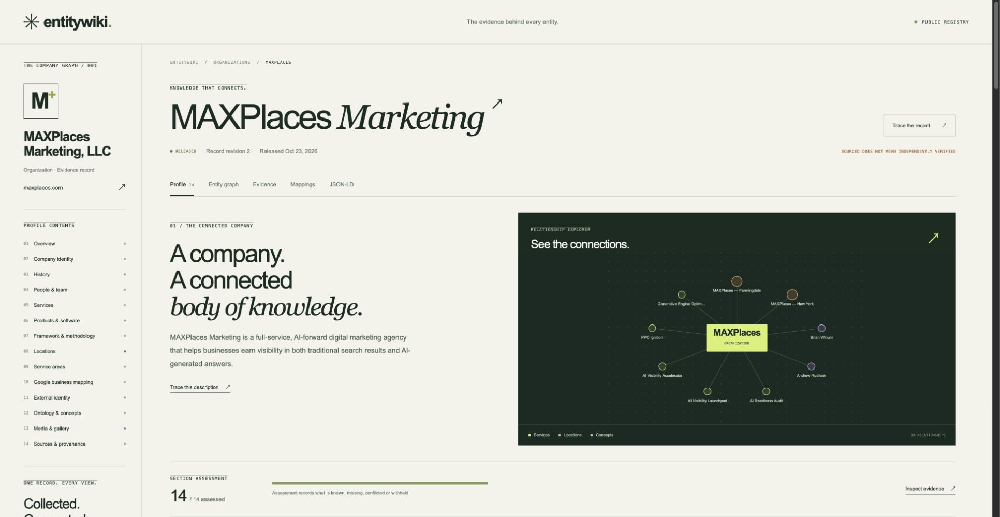
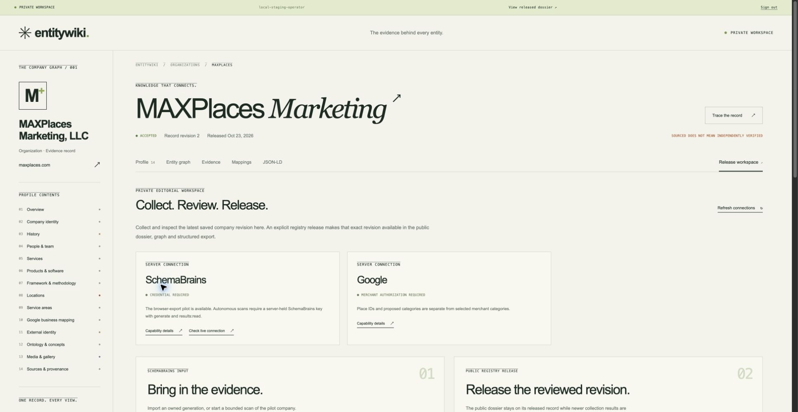

# Isolated registry implementation receipt — October 23, 2026

This implementation keeps public dossiers at the existing `.org` paths and reserves `.com` for the platform/admin. It has not changed production DNS, routing, the original Sites pilot or MediaWiki content. The current `.com` redirect remains untouched.

## Validated locally

- The initial foundation passed 40 tests. Follow-up verification is recorded below; TypeScript, ESLint and production build are rechecked after code changes.
- Both SQL migrations applied to a fresh isolated local D1 database.
- The real accepted MAXPlaces snapshot restored without acquiring sources or calling the live wiki: record `rev_1457a83ebaa25934ec7241c23ee2b226`, numeric revision 2, all 23 entity IDs and 244 claims preserved.
- An explicit staging web release serves the profile, graph, JSON-LD and revision endpoint from the same accepted record. Restoration alone leaves public endpoints unavailable. Subsequent accepted imports remain private until explicitly released.
- Six Product Ontology mappings and two branch Google Place IDs remain accepted. One NYC postal conflict remains unresolved; selected GBP categories remain unknown.
- Anonymous private API requests return 403. Local UI sign-in and sign-out were verified. Production Access JWT tests reject invalid signatures, issuer, audience, expiry and non-allowlisted operators. Production SSO itself is not provisioned.
- The `/id/ew_a3d1e72a720be01b2e5834cb` route returns 303 to `/MAXPlaces_Marketing`; JSON-LD uses the permanent `https://entitywiki.org/id/` namespace without the preview origin.
- Browser checks passed for the public reader, ontology/Google mapping view, private release workspace and registry-to-dossier navigation. An upstream Vinext client navigation/prefetch defect was avoided using ordinary full-document links. Final navigation produced no new console errors. Public pages have no mutation controls; staging remains noindex. The operator UI was left signed out.
- The isolated registry database was captured privately with SQLite's online backup operation and reopened successfully: integrity check `ok`, one accepted record, 244 claim rows and one web release. This is a registry rehearsal backup, not the source MediaWiki database backup.

## Preservation and remaining gates

The private public-content archive contains 219 pages, 1,046 exposed revisions and 2,980 inventoried URLs, with 681 artifact checks passing. Original pilot source history and accepted evidence are also preserved privately. Raw archives and account data are excluded from Git.

A complete original-host SQL/files/configuration backup is still required. A separate protected Cloudways PHP recovery app has since been provisioned, with an app baseline backup, HTTPS/password protection and noindex. Original A2 SQL/files access is pending; that app baseline is not the source wiki backup. Restore and reconcile every client, namespace, account/permission and historical record before cutover. Historical/query/file-route compatibility is inventoried rather than implemented in the new reader.

The new isolated runtime has no live SchemaBrains credential, Google merchant credential, production database or configured production identity provider. The original owner-private pilot's earlier live SchemaBrains generation is preserved in the migrated record; this rehearsal does not claim a fresh external scan. Configure the intended server secrets and production ownership separately. No live-wiki write credential or enabling switch is exposed by the replacement.

New service releases now capture complete canonical public projection snapshots atomically with their release ledger rows; older digest-only releases remain uncaptured. A changed projection still fails closed until a newly reviewed web release. Preserve the matching source/build and database for rendering recovery. See [migration acceptance](migration-preservation.md) for the complete cutover requirements.

## Whole-system preparation while A2 access is pending

The [ecosystem assessment](ecosystem-assessment.md) explicitly separates whole-installation recovery from the MAXPlaces-only registry runtime. Every client, namespace, history/account/permission, template/link graph, media/storage dependency and custom extension remains in scope. Retain the native MediaWiki reader for legacy/history/system behavior until equivalent replacement behavior is validated.

The private [URL preservation ledger](url-preservation.md) reconciles all 219 captured pages, 1,046 exposed revisions and 2,980 exact URLs with zero captured-input issues. All succession decisions are still unresolved; no redirect rules are generated. Server logs, private/deleted records, files and virtual/query/API routes remain additional discovery work.

Read-only SQL diagnostics now cover external text-storage flags and conditional link/template/category/redirect/interwiki/log/account/permission/job/cache checks against the actual complete table inventory. They have not run against the unavailable source database. Optional core columns were checked against the official MediaWiki 1.39 schema.

Local identity regressions now distinguish same-name offerings with different publisher keys, bind Google matches to exact stable branch/address identities, and attach historical postal conflicts only to the proven branch. Google public projections use explicit fields; a permitted Place ID cannot expose merchant resource IDs, private notes or unapproved categories. The original accepted snapshot bytes and all 23 entity IDs remain unchanged. New normalization uses mapping version `maxplaces-registry/2.1.0`.

See [exact release preservation](release-preservation.md) for atomic snapshots, corruption/replay/concurrency tests and operator-only artifact export. No new external scan, original-host backup, all-client import, production deployment, DNS or live-wiki change is claimed by these preparations.

Follow-up verification: **66 tests**, TypeScript, ESLint and production build pass. Migration `0002_flowery_hemingway.sql` applied successfully to the isolated local D1 database. The rebuilt localhost runtime restored the exact accepted snapshot, preserved 23 entity IDs, six PTO mappings, two Place IDs and one conflict, captured a new exact release artifact, verified its digest/content and rejected anonymous artifact export. No Cloudways/source import or external deployment was performed.
